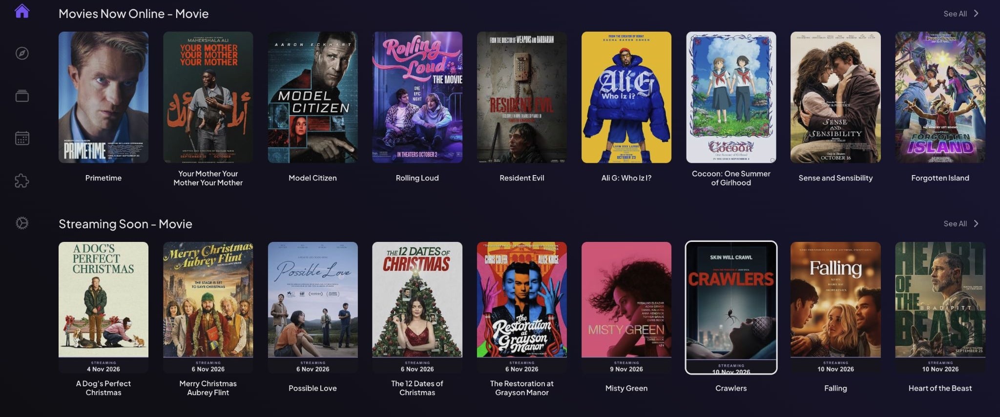
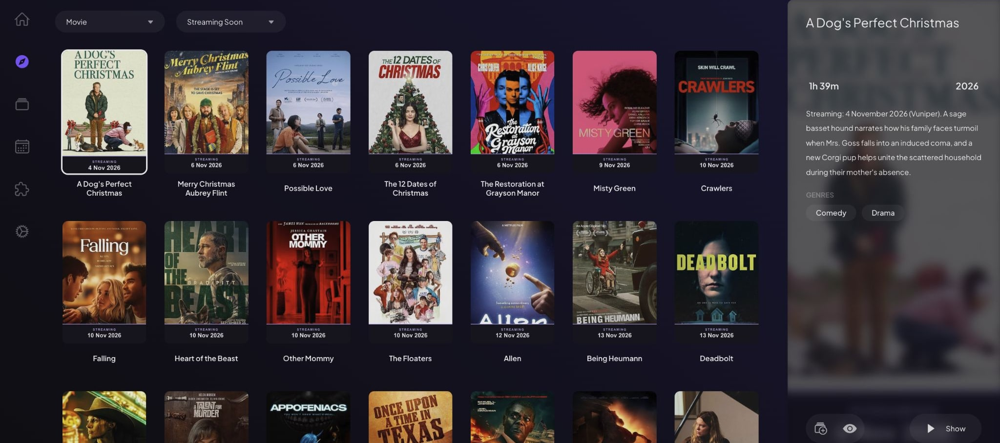
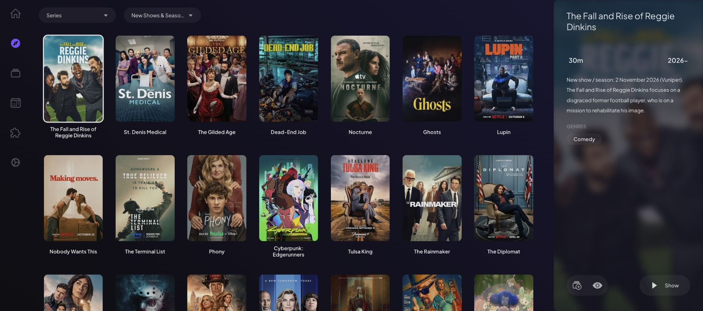

<p align="center">
  
</p>

<h1 align="center">Vuniper for Stremio</h1>

<p align="center">
  New movies, hidden gems, upcoming streaming releases, and returning TV seasons.<br>
  Four catalogs, right inside Stremio.
</p>

<p align="center">
  
  
  
</p>

<p align="center">
  <a href="#catalogs">Catalogs</a> ·
  <a href="#screenshots">Screenshots</a> ·
  <a href="#quick-start">Quick start</a> ·
  <a href="#install-in-stremio">Installation</a> ·
  <a href="#hosting">Hosting</a> ·
  <a href="#development">Development</a>
</p>

An **unofficial Stremio add-on** powered by [Vuniper](https://vuniper.com). Browse the latest releases and upcoming streaming movies from your Board or Discover screen.

No Vuniper login, API key, or Stremio credentials are required by the add-on. It provides catalogs; Cinemeta supplies normal movie and series details, and your other installed add-ons handle playback.

## Catalogs

The catalogs appear in this order within Vuniper:

| Catalog | Order | Posters |
| --- | --- | --- |
| **Now Streaming** | Newest streaming release first | Original artwork |
| **Streaming Soon** | Nearest streaming release first | **STREAMING** ribbon with the release date |
| **Hidden Gems** | Newest streaming release first, using Vuniper's selections | Original artwork |
| **New Shows & Seasons** | Most recent show or season start first | Original artwork |

Only **Streaming Soon** has a date ribbon. New Shows & Seasons uses the latest season's date, rather than the show's original premiere, and opens as a series in Stremio.

### Fresh data when Stremio requests it

- Hosted catalogs share a five-minute snapshot. During a source outage, the add-on can serve a saved snapshot up to 24 hours old.
- Catalog responses disable caching. Stremio controls when it requests a reload; resuming an already open app can temporarily preserve the existing view.
- Streaming Soon posters include the date in their image URL, so a changed release date produces a new poster URL.
- IMDb IDs preserve compatibility with Cinemeta and other add-ons.

Release dates and catalog membership come from Vuniper and may change.

## Screenshots

Captured in Stremio Web. Only the website content is shown; titles and dates reflect the catalog at the time of capture.

### Board

Now Streaming appears first, followed by Streaming Soon with its release-date ribbons.



<details>
<summary><strong>Explore the Discover views</strong></summary>

### Streaming Soon

Browse upcoming streaming releases with the date visible on each poster.



### New Shows & Seasons

Browse new and returning series with their original posters, without date ribbons.



</details>

## Quick start

Requires **Node.js 22 or newer** and npm.

```sh
git clone https://github.com/johncodeos/vuniper-stremio.git
cd vuniper-stremio
npm ci
npm start
```

The add-on starts on `127.0.0.1:7000`. Its installation URL is:

```text
http://127.0.0.1:7000/manifest.json
```

Keep the process running while using the add-on. Press **Ctrl+C** to stop it.

## Install in Stremio

### Stremio Web

1. Keep the add-on running on your computer.
2. Open [Stremio Web → Addons](https://web.stremio.com/#/addons) on the **same computer**.
3. Click **Add addon** and paste `http://127.0.0.1:7000/manifest.json`.
4. Click **Add** and complete installation if prompted.
5. Return to **Board** to find the four catalog rows, or choose them in **Discover**.

### Stremio desktop

Open **Add-ons**, paste the manifest URL into the add-on search field, and install **Vuniper**.

For a TV, phone, or another computer, use a reachable HTTPS deployment. `127.0.0.1` always refers to the device you are currently using; it does not point to a different computer running the add-on.

### Updates and catalog order

Refresh Stremio to load updated movie lists and posters. When an update changes the available catalogs, their order, or add-on branding, remove the installed Vuniper entry and install the same manifest URL again.

**Now Streaming** is Vuniper's first catalog. To place Vuniper above other providers on the Board, reorder your installed add-ons in Stremio. An unofficial utility such as [Stremio Addon Manager](https://stremio-addon-manager.vercel.app/) can do this, including moving Vuniper above Cinemeta; it requires access to your Stremio account.

With Vuniper first, Now Streaming is the first movie catalog for a fresh Discover selection. A previously selected catalog URL can still preserve another choice. For direct access in Stremio Web, bookmark [Now Streaming](https://web.stremio.com/#/discover/http%3A%2F%2F127.0.0.1%3A7000%2Fmanifest.json/movie/movies-now-online).

## Configuration

| Variable | Default | Purpose |
| --- | --- | --- |
| `HOST` | `127.0.0.1` | Interface the add-on listens on |
| `PORT` | `7000` | HTTP port |
| `PUBLIC_URL` | Request origin | Public HTTP(S) origin used for Streaming Soon poster URLs |

Use a different local port:

```sh
PORT=7001 npm start
```

The application reads environment variables from the process. It does not automatically load a `.env` file.

## Hosting

Deploy the Node.js process behind **HTTPS** to use the add-on across devices. Set the host-provided port, bind to `0.0.0.0`, and supply your public origin:

```sh
HOST=0.0.0.0 PORT=7000 PUBLIC_URL=https://your-addon.example.com npm start
```

Then install:

```text
https://your-addon.example.com/manifest.json
```

`PUBLIC_URL` must contain the origin only, without a path, query, or credentials. Set it when using an HTTPS reverse proxy so generated poster URLs use the correct public address.

The poster renderer uses [Sharp](https://sharp.pixelplumbing.com/) and an installed sans-serif font. Arial is available on macOS; Linux deployments should provide a font such as **DejaVu Sans**.

GitHub hosts this project's source code. Running the add-on on a public HTTPS host is a separate step.

For personalized setup and persistent catalog snapshots, configure a writable systemd
`StateDirectory=vuniper-stremio` and supply a 32-byte binary key as
`LoadCredential=settings-encryption-key:/path/to/settings-encryption-key`.
Generate it once with `openssl rand -out /path/to/settings-encryption-key 32` in a
root-only directory, then restrict the file to mode `0600`. Keep the key with your
protected backups so you can restore the encrypted settings. Outside systemd, set
`STATE_DIRECTORY` to an existing private directory and `SETTINGS_KEY_FILE` to the key file.

Optional systemd credentials:

| Credential name | Contents |
| --- | --- |
| `settings-password` | Password for the legacy loopback-only admin page on port 7001 |
| `catalog-proxy` | One authenticated proxy URL per line for Vuniper catalog requests |
| `webshare-api-token` | Webshare API key for fetching replacement proxy endpoints on failure |

Deploy from a specific Git commit in a clean release directory. Run `npm ci` and
`npm test` there, then point the service's `WorkingDirectory` at that release.
Keep the state directory and credentials outside the checkout. Back up both before
deploying a version that migrates settings. Restart the service and check
`/health`, all four catalog URLs, and `/health/catalogs` before retiring the
previous release. Rolling back across the credential encryption migration
requires restoring the matching pre-migration settings backup.

## Development

```sh
npm run dev        # Restart automatically when source files change
npm test           # Run the offline test suite
npm run check:live # Check the real feeds, ordering, pagination, posters, and logo
```

The offline tests cover source pagination, date selection, catalog order, fresh requests, error recovery, timeouts, poster rendering, and the Stremio HTTP endpoints. The live check requires internet access and contacts Vuniper and the poster sources.

```text
src/
  index.js       Process startup and environment configuration
  server.js      Stremio HTTP endpoints
  catalog.js     Catalog definitions, metadata, and sorting
  vuniper.js     Source requests and pagination
  posters.js     Streaming Soon date ribbons and image caching
scripts/
  check-live.js  Live integration checks
test/           Offline tests
```

<details>
<summary><strong>Endpoints and integration details</strong></summary>

### Endpoints

| Path | Purpose |
| --- | --- |
| `/manifest.json` | Add-on identity and catalog definitions |
| `/catalog/movie/movies-now-online.json` | Now Streaming |
| `/catalog/movie/streaming-soon.json` | Streaming Soon |
| `/catalog/movie/hidden-gems.json` | Hidden Gems |
| `/catalog/series/new-shows-seasons.json` | New Shows & Seasons |
| `/poster/v3/{date}/{source-id}.jpg` | Poster with a streaming date ribbon |
| `/health` | Process health without an upstream request |
| `/health/catalogs` | Snapshot timestamps and freshness for each catalog. Returns 503 if any snapshot is stale or unavailable. |

Catalogs return up to 100 entries per page. Append `/skip=100.json`, `/skip=200.json`, and subsequent offsets to the catalog path for additional pages—for example, `/catalog/movie/movies-now-online/skip=100.json`.

### Source behavior

The integration uses Vuniper's internal website API. Now Streaming, Hidden Gems, and New Shows & Seasons start from the same curated initial feeds as the website, then paginate with their original date cursors. Streaming Soon is read in full; the other feeds load the prefix needed for the requested Stremio page.

Movie streaming catalogs use the `web` date. The series catalog uses `last_season_date`. Dates are displayed as calendar dates rather than precise release times. Incomplete records are omitted and counted in the server log, and duplicate IMDb IDs are removed within each catalog.

Source requests have a 20-second overall timeout, a 2.5-second proxy attempt timeout,
and guarded pagination. Persistent deployments share one in-flight refresh per catalog,
reuse a fresh snapshot for five minutes, and serve the last successful snapshot for up
to 24 hours if the source fails. The `X-Catalog-Fetched-At` and `X-Catalog-Stale`
headers report which snapshot was served. A missing or expired snapshot still returns
HTTP 502 during an outage. The snapshots refresh when users request the catalogs.

Rendered posters use a bounded in-memory cache of 128 images for up to six hours. This image cache is separate from catalog freshness. Original posters are used directly for the other three rows. Legacy labeled poster URLs remain supported for cached clients.

</details>

## Attribution and data access

Catalog data and branding come from [Vuniper](https://vuniper.com). Artwork and metadata belong to their respective owners. This project is independent of Vuniper and Stremio.

Vuniper's [terms](https://vuniper.com/terms) restrict automated API access without written consent. Obtain Vuniper's permission before operating this integration. The internal API can change or become unavailable.

Built using the [Stremio add-on protocol](https://stremio.github.io/stremio-addon-sdk/protocol.html), [Sharp](https://sharp.pixelplumbing.com/), and [he](https://github.com/mathiasbynens/he).

---

Created by [**John Codeos**](https://github.com/johncodeos).
